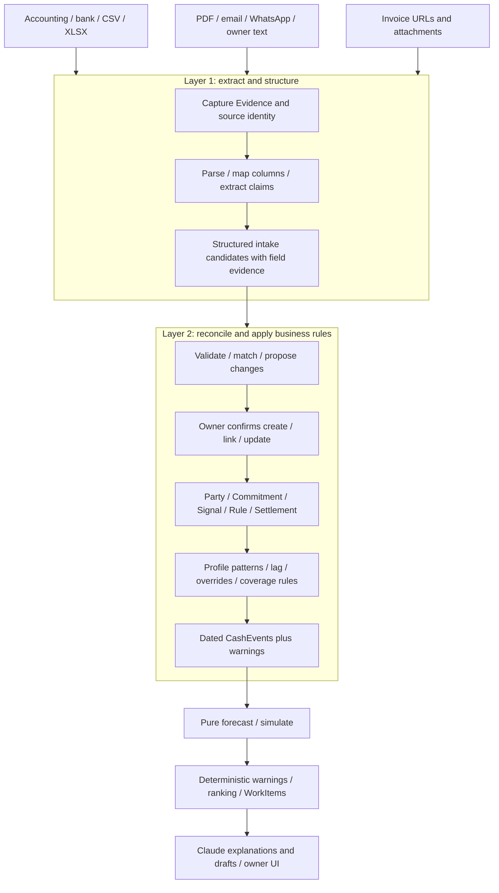

# Neri Cash: technical implementation plan

Status: implementation proposal, October 25, 2026. This repository currently contains design documents and contributor setup scripts; application modules, migrations, fixtures, and test suites still need to be built.

This is the execution companion to [CLAUDE.md](../CLAUDE.md) and the [primary design](design/01-overview-and-architecture.md). It makes the two ingestion layers explicit, defines their handoffs and persistence behavior, and maps them to five owners. It preserves the primary design's shared records, profile-driven behavior, 13-week forecast, certainty ladder, payment-lag model, and read-only adapters. The earlier [seven-hour plan](HACKATHON_PLAN.md) remains a source of demo arithmetic, not the current architecture.

## 1. Two ingestion layers, one shared core



**Layer 1 answers “what does this source say?”** Its output is a candidate, not permission to change cash. Structured accounting rows bypass language extraction but use the same validation/review boundary.

**Layer 2 answers “what does this mean for this business?”** It resolves identity and duplicates, confirms canonical changes, applies profile patterns and payment behavior, and constructs dated cash events. Its two responsibilities have different owners: person 4 proposes/validates record changes with person 1; person 2 turns confirmed records into events. Person 3 owns confirmation endpoints/UI and person 5 coordinates persistence transactions.

Forecasting sums events; it does not parse invoices. Claude extracts, explains, and drafts; it does not calculate balances or ranking scores. These are module boundaries within one application, not a requirement for separate services.

## 2. Implementation choices and layout

Follow the existing [repo/lane contract](design/09-api-repo-lanes.md). Do not introduce a competing `src/lib` schema or a second frontend framework.

| Area | Implementation decision |
|---|---|
| Language and contracts | Strict TypeScript. `schema/records.ts` implements the six core records and supporting types from [03](design/03-data-model.md). Add Zod runtime schemas alongside it; every lane imports them. |
| Application | One Node application serving `api/` and `app/`. Reuse the working Node/Supabase/HTML prototype only if the owner confirms event eligibility and availability. Fresh-build default: a small Fastify API serving a static HTML/CSS/TypeScript app, with Vite only for browser bundling. |
| Store | One `Store` interface. Fresh-build default: SQLite through `better-sqlite3`, prepared SQL, migrations, foreign keys, WAL, bounded busy timeout. If reusing a working Supabase store, implement that interface there instead; never maintain both stores during the sprint. |
| Parsing | `csv-parse` for CSV, ExcelJS for XLSX, PDF.js for embedded PDF text. Preserve row/sheet/page locations. Thin PDF/XLSX intake is required; long-tail formats and generic layout learning beyond pilot examples are stretch. |
| AI | Official Anthropic TypeScript SDK with schema-constrained outputs for record candidates. Current accessible model IDs live in server configuration. Validate responses in application code too. |
| Verification | Vitest for pure engine/golden and store tests; one Playwright end-to-end flow once the app exists. |
| Deployment | One long-running Node service. A SQLite deployment needs writable persistent disk and one service instance. A reused Supabase deployment uses its existing database. |

Pin compatible versions and one lockfile at kickoff. None of these packages are installed by this document. Verify production build, database writes, a representative parse, and model access before building against untested SDK assumptions. The prototype/hosting decisions are concrete kickoff dependencies, not claims that code or accounts were inspected.

```text
schema/         records.ts, intake.ts, profile.ts — shared types and validation
profiles/       trading.json, restaurant.json; business-specific terms/settings only
adapters/       zoho_books/, bank_csv/, generic_file/, email/, owner/
engine/         expand, lag, forecast, simulate, warnings, rank
ai/             extraction, reconciliation proposals, prompts, tools, number_check, cache
api/            HTTP routes, store interface/implementation, migrations, confirmation service
app/            onboarding/profile editor, intake, Review, brief/chart, Ask Neri
fixtures/       cascade_trade/, pike_noodle/, expected/
data/private/   private local sources; never committed
```

Reference implementations/docs: [better-sqlite3](https://github.com/WiseLibs/better-sqlite3), [CSV Parse](https://csv.js.org/parse/), [ExcelJS](https://github.com/exceljs/exceljs), [PDF.js Node example](https://github.com/mozilla/pdf.js/blob/master/examples/node/getinfo.mjs), and [Claude structured outputs](https://platform.claude.com/docs/en/build-with-claude/structured-outputs). Framework/store choice must preserve the shared contracts below.

## 3. Shared contracts and invariants

Use the primary [data model](design/03-data-model.md): `Party`, `Commitment`, `CashEvent`, `Signal`, `Rule`, `WorkItem`, plus `Evidence`, `Settlement`, `BalanceSnapshot`, `Override`, `Scenario`, and `Records`. Do not create a parallel `Invoice`/`Obligation` model that downstream lanes must translate again. Invoice/bill/PO are commitment types.

Add an **intake-only** candidate/proposal schema in `schema/intake.ts`. These are not accepted commitments and must never appear in `Records.commitments` until confirmed.

| Contract | Required contents |
|---|---|
| `IntakeCandidate` | ID; evidence IDs; proposed document/claim type; proposed party/reference; nullable amount/outstanding/currency/dates; original invoice/payment URLs; field evidence; extraction version; missing/conflicting facts. |
| `ChangeProposal` | Candidate or Signal/Rule ID; create/link/update decision; target IDs or candidate matches; old/new values with provenance; blocking issues; candidate revision; expected business/store revision. |
| `ConfirmationResult` | Applied/replayed operation ID, new store revision, affected core record IDs, unresolved warnings. |
| `RunContext` | Business/profile scope, record/profile revision, explicit `asOf`, fixed FX map, data freshness, rules version. Passed by API orchestration; pure engine functions receive explicit inputs. |
| `ProjectionBundle` | One input revision/hash; base/stress `ForecastRun`; ranked WorkItems; quality warnings; profile summary. UI chart and brief always use the same revision. |

`PartyCandidate` is an unresolved name/provider ID/contact set, not a confirmed party. Field evidence points to an Evidence ID plus a page, sheet/row/cell, message excerpt, or provider field path. Model confidence is a hint for review; it never authorizes a write. Missing facts stay unknown, never zero or a guessed currency/date.

IDs follow [CLAUDE.md](../CLAUDE.md): stable source-derived IDs where possible, scoped to the business. Source identity includes provider entity type and source record ID; hash/canonicalize when needed. Globally unique storage keys may include business scope, but a re-import must preserve the same logical record identity. An invoice number alone is not globally unique.

Money uses integer minor units in `amount`, with currency precision explicit. Validate safe integer inputs and every sum. Parse source decimal strings without floating-point money accumulation. Dates use ISO calendar strings and UTC date arithmetic; the business timezone determines how message instants and bank dates become calendar dates. Monday-to-Sunday is a presentation grouping, not a reason to skip weekend cash.

### Functions each lane publishes first

- Person 1: adapter capture/parse → Evidence plus candidates or mapped `Normalized` proposals; no future CashEvents from raw documents.
- Person 4: `extract(evidence, profile) → IntakeCandidate[]`; `propose(candidate, records, profile) → ChangeProposal`. Structured responses are validated before persistence.
- Person 3/5: `confirm(proposal, decision, expectedRevision, idempotencyKey) → ConfirmationResult`, implemented as one store transaction.
- Person 2: `expand`, `lag`, `forecast`, and `simulate` over shared records/profile/scenario and explicit date/rates.
- Person 5: warnings/rank → WorkItems and a consistent projection bundle; stable reminders/work-item state.
- Person 4: tool-backed brief/Ask Neri/drafts from engine outputs, then `number_check` and citations.

Before creating the actual schema file, freeze these contracts with all five owners. Existing design examples are sketches, not already-compiled types. Any post-freeze schema additions must be optional and communicated; never silently rename fields.

## 4. Persistence, revisions, and atomic confirmation

One table/collection per accepted core record type, plus the operational state below. Every query/mutation resolves the business scope server-side; a supplied record ID alone is not authorization.

| Store area | State and constraints |
|---|---|
| Core records | Business-scoped accepted Parties, Commitments, actual CashEvents, Signals, Rules, Settlements, Balances, Evidence; supporting overrides/scenarios. |
| `intake_candidates` / `change_proposals` | Candidate payload, issues, evidence, revision, proposed/applied/dismissed state. |
| `provider_links` / `record_evidence` | Unique business/provider/entity/source mapping; many evidence items per commitment. New payload hashes are source revisions, not new commitments. |
| `po_invoice_allocations` | PO, invoice, allocated amount/currency, confirmation provenance; prevent over-allocation and full PO plus full invoice double counting. |
| `column_mappings` / `aliases` | Confirmed mapping per header/layout hash; business-specific demo aliases. |
| `profiles` / `store_revisions` | Owner-editable profile values and monotonic business revision; canonical changes and profile edits advance it. |
| `forecast_runs` | Input hash/revision, fixed FX map, base/stress output, daily/weekly results for change comparison. |
| `work_item_state` / `reminders` | Stable subject/check/lever identity, state, next follow-up, scheduled reminder, latest computed impact. |
| `mutations` / `audit_log` | Idempotency key/request digest/result, before/after fields, evidence, actor/session and time. |

`Store` must expose snapshot reads and an atomic confirmation operation. SQLite uses one short transaction; a Supabase implementation needs an equivalent database transaction/RPC rather than multiple independent HTTP writes. Network/model calls occur outside transactions.

Confirmation algorithm:

1. Validate scope/schema. Require candidate/proposal revision, expected business revision, and `Idempotency-Key`.
2. Replay a completed identical mutation before checking revisions. Same key/different request returns `409 IDEMPOTENCY_CONFLICT`.
3. Inside the transaction, recheck proposal state and revisions. Stale input returns `409 STALE_REVIEW` without partial writes.
4. Apply accepted record/evidence/provider links, allocations or settlement changes, provenance, audit entry, and increment business revision once. Persist replay result atomically.
5. Read a fresh projection bundle after commit. Retrying that read must not repeat the write.

Concurrent confirmation of two representations of one invoice cannot create two commitments: the second must refresh its proposal after a revision conflict and see the first match. Source refresh cannot erase owner timing overrides. An evidence-only link changes provenance/revision without adding another cash event.

## 5. Layer 1: source evidence to structured candidates

Capture message text, links, and attachments as one source bundle with separate Evidence identities. Channel and format are independent: WhatsApp may carry an XLSX invoice; email may carry a PDF and hosted invoice link for the same commitment.

| Source | Required path | Failure behavior |
|---|---|---|
| Zoho / CSV | Known field mapping, source IDs, outstanding/settlement history; CSV fallback survives connector failure. | Row-level errors; show partial import and missing payment history. |
| Bank statement | BalanceSnapshot, uniquely identified actuals/Settlements, proposed recurrence. Match payment allocations rather than duplicating accounting settlements. | Unallocated actuals remain visible; no guessed invoice match. |
| XLSX | Read sheets/cells; owner confirms tabular mapping or document interpretation. | Multiple invoices stay separate; line items plus subtotal/total must not be summed twice. Cached formula values or manual completion; no promise to execute Excel formulas. |
| PDF | Text extraction per page, then schema-constrained interpretation. | Image-only, encrypted, unreadable, or ambiguous input requests manual completion; OCR is stretch. |
| Email / WhatsApp / owner | Paste/export/upload plus source timestamp and excerpt; extract claims and proposed documents/rules. | Unknown parties are quarantined for explicit identity review, not silently accepted or discarded from owner-submitted intake. Continuous inbox filtering may ignore irrelevant messages. |
| Invoice URL | Preserve original invoice/payment URL; read-only provider API or supported public page when available. | Login/expired/unsupported page retains evidence and requests PDF/manual fields. Do not pretend the link was read. |

Do not silently truncate source material into an apparently complete invoice. Start with limits of 5 MiB/file, 10 PDF pages, 500 rows, four sheets/50 columns, and 50,000 text characters; outside these bounds ask for splitting/mapping/manual completion. These are implementation limits to validate against pilot examples, not business-specific constants.

Resolve URLs server-side through supported HTTPS hosts, validate redirects/destination IPs, block private/reserved addresses, and cap size/time. Capture payment URLs without invoking Pay now or payment APIs. Treat file/page/message contents as extraction data, never tools/instructions.

For the sprint, await bounded processing in the request rather than adding a distributed queue. Budget 10 seconds for URL retrieval, 30 seconds for one model call, 60 seconds for the full request; verify host limits. Persist received/processing/review-ready/needs-input/failed state with a processing token and two-minute expiry. Only the current token can save results; expired attempts can retry without duplicate candidates or late stale writes. Cap extraction concurrency at two in local pilot mode and return a visible busy/retry response beyond that. Never rely on work continuing after the HTTP response.

Model extraction is one logical document per request. A multi-document workbook needs confirmed tabular mapping or splitting. Deterministic mapped imports can preview batches; cap atomic confirmation at 100 candidates and retain visible partial-batch state.

## 6. Layer 2: reconciliation, rules, and cash events

### A. Accept the right records — persons 1/4, confirmation API by 3/5

- Resolve business seller/buyer role and customer/supplier identities; one party can play both roles. If `Party.kind` needs broader roles, add an optional role list at schema freeze rather than duplicate the party.
- Match confirmed provider links first. File hashes identify repeated evidence, not financial identity by themselves. Otherwise propose a match using confirmed party, type/direction, reference, currency, and consistent amount/date.
- Amount proximity or a single open commitment may suggest a target, but cannot confirm it. Review all new document-derived commitments and cross-source links. Unresolved totals/currency/vendors add no new events.
- Preserve original amount, outstanding, settlement status, timing overrides, and field evidence independently. An old PDF cannot restore an outstanding balance or imply payment.
- A promise changes expected timing, not settlement. A hosted invoice/Stripe link is not payment evidence. Settlement requires identified actual payment evidence or explicit owner confirmation and allocation.
- A PO is only a candidate until confirmed. After confirmation its status follows the profile/owner decision; remaining PO amounts can contribute as likely/committed, while the invoiced portion is replaced by linked invoices. Unconfirmed PO candidates never enter the main line just because a model called them likely.
- Source changes become proposals; preserve the earlier source revision and audit trail. Never treat a changed provider payload as a second commitment.

### B. Apply profile-driven rules — person 2

Use [payment patterns](design/02-business-profile.md) and the [engine design](design/05-forecast-engine.md). All defaults, thresholds, lead times, lag shrinkage, relationships, and vocabulary come from the profile or confirmed party rules; the engine has no business-name branching.

1. Expand each accepted commitment through its pattern legs. Allocate minor units with an explicit remainder policy so legs sum exactly to outstanding cash. Estimate missing anchors only from configured lead times and annotate `basis`; unresolved anchors produce warnings, not invented dates.
2. Apply the specified shrinkage lag over at most the last 12 comparable fully paid invoices. Preserve signed early payments. `k` and default lag come from profile; a confirmed party rule replaces the model. Convert fractional days to whole calendar days using a declared rounding rule, visible in `basis`.
3. Apply confirmed rules, then applied signals, then scenario overrides; record all IDs in `overriddenBy`. A date promise on one invoice can therefore override a general lag rule. New raw signals cannot change cash before confirmation.
4. Schedule supplier outflows by contractual/agreed dates. Flexibility permits a proposed simulation, not evidence an extension was granted. Payroll/non-deferrable flags prevent routine deferral suggestions.
5. Expand recurring payroll/costs and profile revenue patterns. Use a coverage key and explicit ownership between aggregate estimates and detailed commitments so payroll bills or daily-sales receipts are not forecast twice.
6. Allocate confirmed PO/invoice overlap in the same currency and tax basis. Reduce only the covered portion; validate that allocations do not exceed PO/invoice amounts.
7. Exclude `possible` from the main line. Actual + committed + likely form the main forecast; probability-weighted possible events form a separate pipeline band. Never describe that band as available money.
8. Stress delays unsettled customer receipts seven calendar days and excludes likely funding. Actual receipts and planned outflows remain unchanged. This is sensitivity analysis, not a confidence interval.

Opening-cash boundary: use the latest start-of-day BalanceSnapshot on/before `asOf` per account. Actual movements already in the snapshot are not emitted again; roll forward identified actuals between snapshot and as-of. Payments on/after as-of contribute once and reduce expected outstanding cash. The accounting Settlement and bank line for the same payment must share an allocation/identity rather than emit two actuals. Unpaid expected receipts from the past remain overdue/unscheduled warnings; never roll them into opening cash as if received.

Example: opening $100, then actual receipt $20 against a $50 invoice after the snapshot → actual +$20 once and expected +$30. Do not emit +$50 expected as well, or silently discard the actual payment. Missing payment dates/allocations require reconciliation.

## 7. Forecast, simulations, warnings, and AI

Keep the existing `forecast`/`simulate` interfaces, with one explicit fixed-FX-map argument added in the design contract. FX conversion must not fetch rates inside pure functions. Capture/validate rates at the API boundary and save them with the run. An unsupported/missing foreign rate raises a quality issue; never assume 1:1. A base-currency-only fixture works with rate 1.

Use `profile.horizonWeeks` (13 by default), Monday–Sunday weekly buckets, with a partial first week from as-of and daily detail underneath. Define the exclusive horizon end as Monday of the as-of week plus `horizonWeeks × 7` days. Exclude days before as-of; 13 buckets therefore contain 85–91 forecast dates. UI derives dates from the run rather than assuming 91 elements.

Compute daily cash first, then aggregate weeks. Low point, first-negative, safety warnings, and free-cash windows must inspect daily minima: weekly closing cash cannot hide a midweek payroll deficit. Keep the low point's week for existing UI contracts and add optional exact date. Safe integer arithmetic and deterministic FX rounding are required. Derive input hash from canonical sorted records/profile/scenario/as-of/rates and rules version; exclude generated IDs/timestamps from the hash.

Warnings and ranking stay in person 5's lane. Use the profile-driven score in [07](design/07-warnings-and-ranking.md); clamp days-to-deadline at zero so past deadlines cannot produce a divide-by-zero/negative urgency score. Determine `neededBy` from profile-configured action lead times and the risk date; unknown timing produces Review/Watch instead of an invented deadline. Simulate every actionable lever in isolation and report its assumptions, low-point delta, and before/after risk. A suggested supplier extension remains conditional.

Define optional `profile.actionLeadDays` keyed by supported lever/action kind and `profile.thresholds.staleAfterHours` at contract freeze, with actual starter values in the profile files. These are configuration, not hard-coded engine defaults. If a free-cash lookahead extends beyond the available forecast horizon, label its coverage as incomplete; do not claim cash stays free for weeks that were never modeled.

WorkItem identity is stable per business/subject/check/lever-kind. Recompute score/evidence for a new forecast revision without recreating completed reminders. Save follow-up dates and reopen only for a material changed fact with an audit reason. Display at most three above the profile's floor; never pad the list.

Person 4 generates brief text, Ask Neri answers, and drafts from engine/tools. No raw document may instruct the answering agent. Require citations and run `number_check` against amounts/dates in the current tool results; one regeneration then deterministic fallback on failure. Cached responses include prompt version, profile, scenario and run input hash. A cache miss in demo mode uses code-built text; never show a cached answer for stale inputs. Ask Neri can propose a commitment/rule/signal and run a what-if, but cannot send, pay, or mark an invoice paid by itself.

## 8. API and UI integration

Preserve the endpoints in [09](design/09-api-repo-lanes.md); do not introduce a second `/api/businesses/...` surface. Business/session scope is resolved server-side on every request. Return a revision/input hash with every forecast/brief result and require expected revision/idempotency keys for writes.

| Endpoint | Technical behavior |
|---|---|
| `POST /import/:adapter` | Capture/normalize → preview counts, Evidence, candidates and proposals. Document-derived records remain pending until confirmation. |
| `GET /review` | Add a unified pending candidate/signal/rule/mapping queue, including conflicts and field evidence. |
| `POST /review/:id/confirm` | Add atomic create/link/update/reject confirmation for document/mapping candidates. |
| `POST /signals/:id/apply`, `/dismiss`; `POST /rules/:id/confirm` | Use the same revision/idempotency transaction service. |
| `GET /forecast?scenario=`; `GET /brief` | Read or compute the same persisted run revision. Add `GET /projection` for one base/stress/WorkItem bundle, so chart and briefing cannot mix revisions. |
| `POST /simulate` | Validate Lever[], apply isolated overrides and rerun; no baseline mutation. Return scenario ID, run and impact. |
| `POST /ask` | Validate question, call engine-backed tools, apply number/citation checks, return Answer or missingData. |
| `POST /work-items/:id/draft`, `/approve` | Draft returns text; approval changes work-item state only. It is never message-sent/payment-completed status. |
| `POST /work-items/:id/remind` | Add persisted next-follow-up/reminder state without changing invoice settlement. |
| `GET /profile`, `PUT /profile`; `GET /records/:id` | Validated editable profile; canonical record with evidence and provenance. |
| `POST /demo/reset`; `GET /health` | Session-scoped synthetic reset; health/readiness without financial content. |

Errors use `{ error: { code, message, fieldIssues, retryable }, revision? }`: malformed request 400, unavailable scoped resource 404, stale/conflict 409, limit 413, unresolved facts 422, busy 429, upstream failure/timeout 502/504. Never log credentials, invoice tokens, or raw financial content in errors.

Person 3 builds against JSON fixtures first. After a confirmed mutation, fetch one fresh projection bundle and replace chart/brief together. Reject stale responses. A `409` refreshes Review rather than resubmitting the same stale decision. Use source links and field evidence in record detail; the UI must not imply a Pay now link means paid.

## 9. Deployment and runtime state

Person 3 owns API route implementation and app integration; person 5 coordinates store infrastructure, deployment, and the run/attention orchestration. Each domain owner supplies their service functions. One owner controls schema migrations/lockfile merges to avoid five incompatible stores.

Public preview/video/repo use synthetic datasets. A per-session signed random cookie isolates synthetic business state; every route enforces that scope. Public intake accepts registered synthetic fixture IDs and bounded simulated changes, not private file/URL/mailbox inputs or live pilot credentials. Real pilot adapters run in a separate loopback-only environment. Masking names alone does not make private financial amounts safe to publish.

Keep server configuration in `.env`: mode, data directory or existing Supabase configuration, session secret, accessible model IDs/API key, and verified connector settings. Check in placeholders only. No new credentials are created by this plan. Private data sent to a model/provider requires the owner's authorization; public synthetic fixtures avoid that dependency.

With SQLite, use one service instance and persistent disk. Apply migrations before readiness; keep DB locks short and make consistent backups/reset snapshots. Do not copy a live SQLite file without its WAL state. Hosted pilot authentication, distributed workers, and horizontal scaling are post-hackathon work.

Trace request ID, adapter, input hash/revision, counts, rule version, latency and error code; keep raw messages, files, tokens and real figures out of logs. Expose stale/incomplete source state to the owner. Probe the actual host's build/native dependencies, persistence and timeout limits before relying on it for the demo.

## 10. Acceptance tests and fixtures

Implement the [existing golden-test strategy](design/10-testing-and-fixtures.md) on both `cascade_trade` and `pike_noodle` without code changes. The existing approximate story targets need concrete fixture balances before they can serve as golden assertions. Add the earlier daily arithmetic fixture as a small exact unit test, not a replacement for the 13-week genericity tests.

| Test group | Required assertions | Owner |
|---|---|---|
| Layer 1 | CSV/XLSX/PDF/message/link candidates; null missing fields; unreadable source fallback; sheet/page provenance | 1/4 |
| Reconciliation | Provider row + PDF + link + chat → one Commitment; different sellers with same reference stay separate; old face total does not erase outstanding | 1/4 |
| Atomic state | Same confirmation key replays, changed payload conflicts, stale competing confirm cannot duplicate records, failed write rolls back | 3/4/5 |
| Actuals/boundary | $100 opening + $20 actual + $30 remaining expected = $150; pre-snapshot payment excluded; bank/accounting representations count once | 1/2 |
| Rules | Shrinkage lag and early payments, override order, partial pattern rounding, overdue dates, recurrence, payroll/daily-sales coverage, PO partial invoice | 2 |
| Forecast | Daily gap hidden by positive weekly close is caught; possible band excluded from main; FX fixed; base/stress/what-if isolated | 2 |
| Warnings/AI | Correct ranked top items, stable follow-up identity, no overdue-score singularity; invented amount fails number_check; tool-less injection cannot mutate | 4/5 |
| Browser | Intake → review → duplicate link → signal confirmation → updated forecast/brief → draft/reminder; profile swap works; public private-data paths blocked | 3/5 |

Exact legacy fixture: opening $15,000 on October 25, 2026; supplier −$20,000 October 29; receipt +$12,000 and tentative loan +$40,000 October 30; payroll −$18,000 November 1. Baseline closing is −$5,000 October 29 and $29,000 November 1. Reschedule supplier to November 4: base $49,000 November 1/$29,000 November 4; stress without loan and receipt delayed to November 6: −$3,000/−$23,000 respectively. Extending to 13 weeks must preserve these daily values.

Proposed CI after scaffolding: locked install → TypeScript check → unit/store/golden tests for both profiles → production build → one browser smoke test. These scripts/tests do not exist yet; no application checks are claimed as passed by this document.

## 11. Five-owner implementation sequence

| Person | Owns | First artifact and integration handoff |
|---|---|---|
| [1](../tasks/01-data-and-source-adapters.md) | `adapters/`, Evidence capture, masking, fixture records | Sample source bundle, mapped records/candidates and payment history; hand to AI/reconciliation and engine |
| [2](../tasks/02-cashflow-engine.md) | `engine/expand`, `lag`, `forecast`, `simulate` | Profile + Records → ForecastRun/impact on both fixtures; hand to warnings, AI tools and App |
| [3](../tasks/03-product-ui-and-onboarding.md) | `app/`, `api/` routes, Review/profile editor | Fixture-backed endpoints/screens, atomic confirm wiring and projection bundle consumption |
| [4](../tasks/04-document-understanding-and-reconciliation.md) | `ai/`, candidate extraction/match proposals, brief, Ask Neri, drafts | Candidate/Signal/Rule proposals with evidence; validated explanations from tools only |
| [5](../tasks/05-actions-integration-and-demo.md) | `engine/warnings`, `rank`, store/integration coordination, deployment/demo | Stable WorkItems, run revision/transaction infrastructure, deployed end-to-end loop |

Use [the committed event schedule](design/11-plan-demo-risks.md), not a new seven-hour clock starting when this document is read. Its listed deadline is 5:30 pm Pacific on October 25; external event timing was not independently reverified for this document. Preserve its integration and feature-freeze checkpoints; adjust remaining work with the team if a checkpoint is already past.

1. **Contract/fixture freeze:** settle the prototype/store choice, write schema/runtime validators and two fixture profiles, and publish candidate/Records/ForecastRun/WorkItem payloads. Confirm adapters/model/native DB probes. Proposed paths currently exist as design, not code.
2. **First vertical slice:** CSV/accounting fixture → review/confirmed records → expand/lag/forecast → warning → home screen. Every lane initially uses frozen fixtures; no wait for AI or live connectors.
3. **Two-layer intake:** PDF/XLSX/message/link → candidates → match/owner confirmation → existing commitment or new accepted record → cash events. Show duplicate evidence adding zero cash.
4. **Owner loop:** confirmed date signal changes the same invoice and re-ranks the brief; Ask Neri runs an isolated scenario; draft/reminder persists with stable identity.
5. **Integration/freeze:** second profile, daily/weekly view, funding uncertainty and source tracing. Each owner repairs their failed acceptance checks; stop adding providers/features.
6. **Submission:** verify exact golden results and synthetic reset/preview, rehearse, cache validated AI outputs or use labeled deterministic fallback, record a backup video, submit with upload buffer.

Protect the primary design's 13-week forecast, real payment lag, one outside signal, warnings and actionable gap remedies, plus the user's document-intake requirement. Stretch includes live CRM, continuous WhatsApp/email sync, partner cards, idle-cash polish, extra profiles, OCR and additional URL resolvers. Keep paste/upload/link retention fallbacks and the second working profile. Nothing sends, pays, moves money, or writes back to a source system.

## 12. Ready-to-build checklist

- [ ] Five owners accept the two-layer handoffs and shared schemas before coding.
- [ ] Prototype eligibility/availability and the single store choice are resolved; no second stack is introduced.
- [ ] Current model access, parsers, production build, DB writes and hosting limits have bounded probe results.
- [ ] Opening balance boundary, payment-history availability and fixed FX inputs are known for the chosen fixture/pilot.
- [ ] Synthetic same-invoice PDF/link/export/message and invoice/PO examples are available.
- [ ] Candidate/Records/Profile/ForecastRun/WorkItem fixtures pass runtime validation; both profile golden outputs are explicit.
- [ ] First vertical slice is integrated before expanding live sources; no application functionality is claimed by this planning change.
